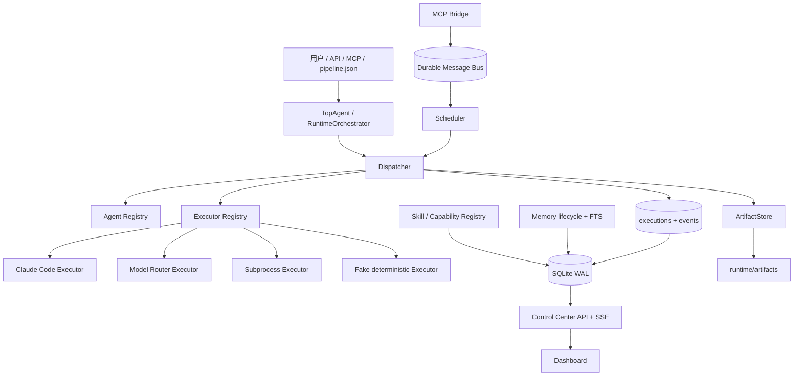
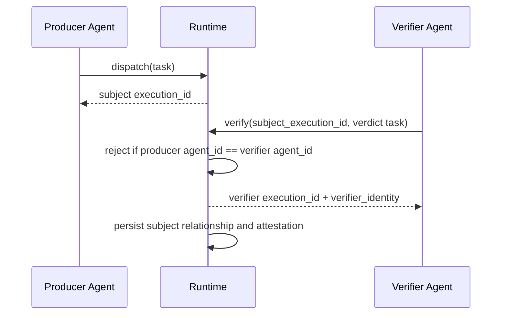
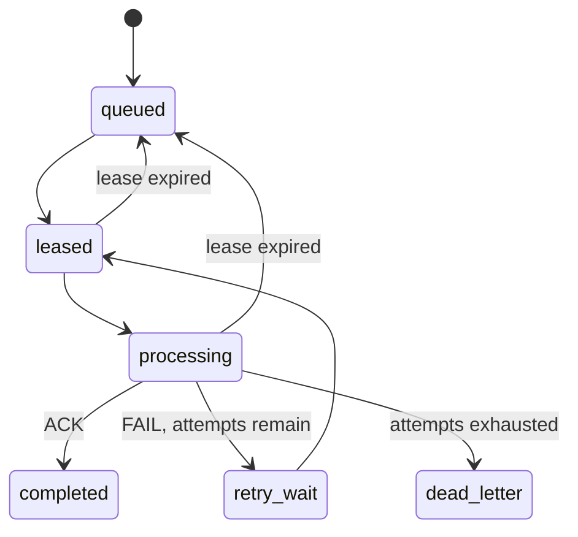

# TopAgent v3 全体系详解

版本：3.0.0
更新日期：2026-08-18
适用工作区：`C:\AI_Project`

## 1. TopAgent 到底是什么

TopAgent v3 不是一个新基础模型，也不是 19 个始终在线的 AI 进程。它由三类东西组成：

1. **定义层**：Agent、Skill、pipeline 和能力契约，说明“谁能做什么、流程如何走”。
2. **执行层**：Dispatcher、Executor、Scheduler、消息总线，负责“真正启动并留下证据”。
3. **运营层**：数据库、Artifact、Memory、Control Center、测试，负责“看得见、能恢复、可审计”。

准确表述：

> TopAgent v3 是一个以文件为定义事实源、以 SQLite WAL 为运行事实源、能够调用本地
> Executor/模型路由并生成执行证据的单机 Agent 编排基线。

不准确表述：

> “仓库里有 19 个 Agent 文件，所以 19 个 Agent 正在独立自主工作。”

## 2. 设计目标

TopAgent v3 解决七个核心问题：

| 问题 | v3 回答 |
|---|---|
| 入口在哪里 | CLI、HTTP API、MCP、pipeline adapter |
| 谁执行了 | execution_id + agent_id + version + backend/model |
| 执行了什么 | task、inputs、structured output、Artifact |
| 是否被篡改 | input_hash、output_hash、content-addressed Artifact |
| 谁审核的 | verifier execution identity + subject execution |
| 失败怎么办 | failed execution、retry、dead-letter、lease recovery、memory conflict |
| 如何证明能力 | Capability Contract + tests + runtime evidence + Dashboard |

## 3. 总体架构



## 4. 六层逻辑模型

### 4.1 交互入口层

入口包括：

- `python -m topagent` CLI。
- Control Center HTTP API。
- MCP Bridge stdio JSON-RPC。
- Router MCP/CLI。
- v2 人工门禁 CLI。

入口只负责接收请求，不负责冒充执行完成。

### 4.2 编排层

`RuntimeOrchestrator` 读取 `orchestrator/pipeline.json`：

- 建立 run。
- 定位 step。
- 读取 step 中的 spawn 定义。
- 为每个 Agent 构造 ExecutionRequest。
- 汇总 execution 结果。
- 根据 gate 类型进入 succeeded、failed 或 awaiting_gate。

旧 `top-agent-orchestrator.py` 仍保留人工确认、产物提交、两级门禁、override、revoke、
escalate 等强制状态机。v3 尚未把它的全部命令重写进 Runtime。

### 4.3 执行层

Dispatcher 是统一执行边界：

```text
dispatch(request)
  1. Registry 解析 Agent
  2. 校验 status/backend
  3. 创建 execution_id 和 trace_id
  4. 计算 input_hash
  5. 创建隔离 execution workspace
  6. 注入 Runtime execution identity
  7. 调用 Executor
  8. 保存 structured output 和 Artifact
  9. 计算 output_hash
 10. 写入 attestation、metrics、events
```

失败同样有 execution_id、error type/message/traceback 和 failed event。

### 4.4 协作层

消息总线不是 MCP 本身。职责拆分为：

- MCP：外部 Agent/客户端通信接口。
- MessageBus：持久状态、租约、ACK、重试、死信。
- Scheduler：把待处理消息转为 execution。
- Dispatcher：实际执行。

### 4.5 知识与能力层

- Agent Registry：定义、版本、模型、backend、状态、内容 hash。
- Skill Registry：metadata 和全文路径。
- ProgressiveSkillLoader：先筛 metadata，再加载命中全文。
- Capability Registry：机器可读能力声明及证据。
- MemoryStore：长期记忆状态机和 FTS。

### 4.6 可观测与安全层

- SQLite event/audit store。
- Artifact 内容寻址。
- Control Center metrics/SSE。
- DPAPI CurrentUser vault。
- 单元、契约、故障恢复和端到端测试。

## 5. 十步交付流水线

权威定义：`orchestrator/pipeline.json`。

| 步骤 | 目标 | 主要执行者 | 门禁 |
|---|---|---|---|
| Step 1 理解需求 | 澄清目标和成功标准 | TopAgent + 用户 | 用户确认 |
| Step 2 分析拆解 | 模块、依赖、风险 | TopAgent | fact-check + QA |
| Step 3 研究检索 | 外部项目与内部经验 | skill-hunter、memory-learning | fact-check + QA |
| Step 4 规划架构 | 架构、选型、ADR | architect-agent | fact-check + QA + 用户确认 |
| Step 5 组建团队 | Agent/Skill 定义 | agent-forge-agent | fact-check + QA |
| Step 6 分配任务 | 模块→Agent→输入输出 | TopAgent | 无 |
| Step 7 监督执行 | 前端、后端、AI、测试 | 开发 Agent 组 | fact-check + QA |
| Step 8 质量终审 | 独立质量裁决 | qa-agent | verdict |
| Step 8.5 反失败 | 根因、止血、改进 | failure-analysis-agent | verdict |
| Step 8.6 评分淘汰 | 评分、回归、换新 | eval-benchmark-agent | verdict |
| Step 9 总结学习 | 文档、数据、记忆 | data-curator-agent | fact-check + QA |
| Step 10 能力进化 | 基准、A/B、回归 | eval-benchmark-agent | verdict |

注意：JSON 实际包含 12 个 step id，因为 8.5 和 8.6 是条件/补充步骤；“十步”是业务阶段
命名，不应与数组元素数量混淆。

## 6. Agent 体系

### 6.1 定义和实例的区别

| 层级 | 证据 | 能说明什么 |
|---|---|---|
| Agent 文件 | `.claude/agents/*.md` | 有一个角色/能力定义 |
| Registry 记录 | version/hash/backend | 定义被机器索引且可重建 |
| Execution | execution_id/trace | 发生了一次可审计执行 |
| Presence | worker_id/heartbeat | 有一个活动 worker |
| 进程/容器证据 | PID/container/host | 真正进程或主机级隔离；当前未实现 |

### 6.2 当前 19 个 Agent 定义

| 分组 | Agent | 作用 |
|---|---|---|
| 总控 | `top-agent` | 唯一组织交付入口和总编排 |
| 历史 | `delivery-director` | 已废弃，能力合并至 top-agent |
| 情报 | `skill-hunter` | 外部项目、工具、Skill 检索 |
| 情报 | `memory-learning-agent` | 经验召回、陷阱和记忆治理 |
| 基础设施 | `model-router-agent` | 模型/Provider 选择 |
| 基础设施 | `tool-manager` | 工具发现、Schema、权限、审计 |
| 团队构建 | `agent-forge-agent` | 创建、版本化、替换 Agent |
| 架构 | `architect-agent` | 系统架构、选型和 ADR |
| 开发 | `frontend-agent` | 前端 UI 和状态管理 |
| 开发 | `backend-agent` | API、数据库、认证、缓存队列 |
| 开发 | `ai-engineer-agent` | LLM、RAG、Agent、训练数据 |
| 交付 | `devops-agent` | 容器、CI/CD、监控运维 |
| 测试 | `test-agent` | 单元、集成、E2E、性能、安全 |
| 质量 | `fact-check-agent` | 三层事实验证和可信度 |
| 质量 | `qa-agent` | 独立质量审核和否决 |
| 质量 | `quality-auditor` | 独立质量审计；与 qa-agent 存在职责重叠 |
| 失败 | `failure-analysis-agent` | 技术、责任、流程根因分析 |
| 评估 | `eval-benchmark-agent` | 基准、A/B、回归和评分 |
| 数据 | `data-curator-agent` | 训练数据采集、清洗、导出 |

已识别技术债：`qa-agent` 与 `quality-auditor` 职责重叠。当前未擅自删除；后续应决定
“一个做任务级 QA、一个做体系级审计”，或合并后保留兼容别名。

### 6.3 Agent backend

现有 Agent 默认 backend 是 `claude`。这表示 Dispatcher 在显式允许付费时会通过 Claude
Code CLI 调用对应 Agent；不表示它们常驻在线。

## 7. Skill 体系

当前 22 个 Skill 定义：

| 分组 | Skill |
|---|---|
| 总控 | `top-agent` |
| 历史兼容 | `delivery-director`（deprecated） |
| 调研 | `skill-hunter`, `github-research`, `env-scan` |
| 规划 | `tech-selection`, `agent-team-design`, `skill-generator` |
| 开发质量 | `code-review`, `bug-diagnosis`, `qa-agent`, `fact-check` |
| 失败/评估 | `failure-analysis`, `eval-benchmark` |
| Agent/工具 | `agent-forge`, `tool-manager`, `model-router` |
| 记忆/数据 | `memory-learning`, `data-curator` |
| 文档交付 | `auto-documentation`, `project-delivery`, `project-closeout` |

### 7.1 渐进加载

```text
Level 0  文件扫描 + content hash
Level 1  name/version/description/status 元数据筛选
Level 2  只加载命中的 SKILL.md 全文
Level 3  执行 Skill 脚本/资源时独立授权（待实现）
```

当前选择器使用本地英文词元和中文二元片段重叠评分。优点是无依赖、确定性；限制是没有
embedding、同义词和语义 reranker。

## 8. 独立验证体系

`verify()` 和普通 `dispatch()` 的区别：



独立性是执行身份层面的硬约束，而不是只看输出里有没有写 `verifier: qa-agent`。

## 9. Executor 体系

### 9.1 FakeExecutor

只用于确定性测试和 smoke，不调用模型。它证明 Runtime、存储和产物链可工作，但不能证明
模型质量。

### 9.2 SubprocessExecutor

- command 必须是字符串数组。
- `shell=False`。
- task 通过 stdin。
- workspace 作为 cwd。
- timeout 后失败入库。

### 9.3 ClaudeCodeExecutor

- 调用 `claude -p`。
- 使用 Agent ID、JSON output、max turns。
- 默认按质量优先允许执行；调用方可用 `allow_paid_calls=false` 或 `--free-only` 显式拒绝付费/订阅额度调用。

### 9.4 RouterExecutor

- 复用 `router.route_and_execute()`。
- 支持现有 Provider fallback。
- 默认按质量优先允许调用；`free-only` 模式会在发起 Provider 请求前拒绝并保留失败审计。
- dry-run 已调整为不读取 Key、不构造 Provider。

## 10. MCP 和消息体系

### 10.1 为什么不能再用 unread/read

read 只说明客户端看过消息，不能证明完成任务。如果进程在 read 后崩溃，消息会永久丢失。

### 10.2 v3 状态机



### 10.3 身份

- Runtime 内发送：自动从 ContextVar 取得 execution identity，`attested=true`。
- MCP 提供有效 sender_execution_id：从 executions 验证后注入身份。
- 旧 `from`：允许兼容发送，但 `attested=false` 并返回 warning。

### 10.4 MCP 不是存储

MCP Server 可以重启；消息状态保存在 SQLite。接口层和持久层分离，避免 stdio 进程成为
单点状态源。

## 11. 长期记忆

### 11.1 生命周期

| 状态 | 含义 | 默认可检索 |
|---|---|---|
| candidate | Agent 新产生，尚未验证 | 否 |
| active | 已验证 canonical truth | 是 |
| conflict | 与活跃事实冲突 | 否 |
| superseded | 被新事实替代 | 否 |
| archived | 过时或人工归档 | 否 |

### 11.2 双存储

- Markdown：人可读、可审阅、可版本管理的 canonical/candidate/archive。
- SQLite + FTS5：状态、关系、指标和快速检索。

当前实现已能写出双份记录，但“从全部 Markdown 自动重建 FTS”仍需补专门 importer；因此
不能把“可扩展重建”误说成“已经完整双向同步”。

### 11.3 遗忘和冲突

当前支持显式 archive/supersede；尚未有周期任务自动按时间衰减。推荐后续增加：

- expires_at 扫描。
- 长期未验证降级。
- 低 use_count 候选清理。
- 冲突队列人工复核。

## 12. Capability Contract

8 项能力契约全部要求以下字段：

```text
entrypoint
execution_code
tests
runtime_artifacts
metrics
failure_recovery
audit
limitations
verification
```

成熟度含义：

| 等级 | 含义 |
|---|---|
| L0-declared | 只有声明或设计 |
| L1-implemented | 有执行代码，验证不足 |
| L2-verified | 有确定性测试和本地证据 |
| L3-operated | 长期运行、告警、SLO 和恢复演练；当前未达到 |

## 13. Control Center

启动：

```powershell
python -m topagent serve --host 127.0.0.1 --port 8765
```

默认地址：`http://127.0.0.1:8765`。

Dashboard 展示：

- 执行总数、运行中、消息积压和死信。
- execution_id、Agent、backend、状态、时间。
- Agent 定义、记忆、Capability maturity/evidence。
- 实时 execution events。

默认只绑定本机。当前没有登录、RBAC、多用户或 TLS，因此不应直接改成公网监听。

## 14. 密钥体系

### 14.1 解析顺序

```text
进程环境变量
  ↓ 不存在
Windows DPAPI CurrentUser vault
  ↓ 不存在
missing
```

### 14.2 安全性质

- `runtime/secrets.enc` 是密文且 Git ignored。
- 复制到另一个 Windows 用户/设备通常不能解密。
- CLI 不回显密钥值。
- 写入采用临时文件替换和解密后 hash 验证。

### 14.3 不解决的问题

- 不能清除旧 Git 历史。
- 不能替代 Provider 端撤销和轮换。
- 当前不提供团队共享 Secret Manager。
- 当前 Windows DPAPI 实现不适用于 Linux CI；CI 应注入环境变量或接企业 Secret Manager。

## 15. Router

Router 由四块组成：

| 文件 | 作用 |
|---|---|
| `config.yaml` | Provider 和 task routing 数据 |
| `config.py` | 配置与 Key 解析 |
| `providers.py` | Provider API 适配 |
| `router.py` | primary + fallback 执行循环 |
| `server.py` | MCP/CLI 入口 |

TopAgent Runtime 的 RouterExecutor 只负责接入，不复制 Provider 逻辑。

## 16. 数据库运行事实

| 表 | 核心用途 |
|---|---|
| runs | 项目级 run 和当前 step |
| executions | 每次 Agent/Executor 执行 |
| execution_events | trace 和状态事件 |
| messages | 消息当前状态 |
| message_deliveries | 每次租约/尝试 |
| artifacts | 内容寻址产物 |
| agents | Agent 定义索引 |
| skills | Skill 定义索引 |
| memories / memory_fts | 记忆状态和全文检索 |
| capabilities | 能力契约索引 |
| capability_evidence | 测试/运行证据 |
| audit_records | 记忆和兼容工具声明等审计 |
| agent_presence | worker 心跳和活动 execution |

## 17. Evaluation Harness

当前评估闭环：

```text
成功标准/测试集
  → Runtime/功能实现
  → unittest + compile + JSON/schema + API 状态核验
  → 结构化失败 traceback
  → 根因修复
  → 完整回归
  → capability evidence
```

生成器与评估器在关键点分离：

- 生产 execution 与 verifier execution 分离。
- FakeExecutor 用于确定性执行，不负责自评。
- Router 的 Provider fallback 用 mock 故障注入验证。
- Message Bus 使用错误 delivery、并发幂等和过期租约做负向测试。

当前没有独立第二模型对 UI/文案做主观评分；该部分可在真实 Golden Case 阶段补充，但不能
替代确定性测试。

## 18. 与 OpenManus / Manus 的关系

### 18.1 OpenManus

参考 [FoundationAgents/OpenManus](https://github.com/FoundationAgents/OpenManus) 的分层
和可扩展 Agent/Flow/Tool 思路。TopAgent 的差异是更强调：

- 人工方案确认和门禁。
- Capability Contract。
- 本地 DPAPI 和审计。
- 既有 10 步交付流程兼容。

### 18.2 Manus Context Engineering

参考 [Context Engineering for AI Agents](https://manus.im/blog/Context-Engineering-for-AI-Agents-Lessons-from-Building-Manus)
中将文件系统作为外部上下文、保留可恢复轨迹的原则。TopAgent 用 execution workspace、
ArtifactStore、SQLite events 和 canonical memory 落地。

### 18.3 Manus Skills

参考 [Manus Skills](https://manus.im/blog/manus-skills) 的按需加载思想。TopAgent 当前是
metadata→词元筛选→全文加载；尚未实现动态安装、权限沙箱和语义 reranking。

## 19. 示例应用与平台关系

### 19.1 manju-studio

AI 漫剧/视频示范应用，包含后端 API、脚本、关键帧、配音、合成和前端。它是 TopAgent
体系的业务示例，不是 Runtime 核心模块。

当前限制：三条稳定视频 Golden Case 尚未建立，所以不能用该项目证明全体系生产级。

### 19.2 video-notes

视频转录、关键帧和笔记生成示例。当前缺固定输入视频、期望转录/关键帧/笔记快照回归。

## 20. 已知问题和下一步

### P0

- 在 Provider 控制台轮换旧密钥。
- 刷新/注销 Manus session，并删除包含 session JWT 的本地离线网页。
- 如私人仓库曾推送旧值，单独审批 Git 历史清理。

### P1

- 合并 v2 人工门禁和 v3 Runtime 的状态源，减少双轨。
- 建立真实 Claude/Router 的受控 Golden Run，限定预算和测试账户。
- 为 manju-studio 建三条 Golden Case。
- 为 video-notes 建固定样本快照。
- Memory Markdown→SQLite 完整重建工具。
- Agent worker 进程隔离和健康管理。

### P2

- OTLP/外部告警和 SLO。
- 企业 Secret Manager。
- RBAC、多用户和远程 Control Center。
- embedding/reranker Skill 和 Memory 检索。
- 仓库进一步拆分 `platform/agents/examples`；实施前需另行方案审核。

## 21. 最小使用路径

```powershell
cd C:\AI_Project

# 1. 重建定义索引
python -m topagent init

# 2. 运行测试
python -m unittest discover -s tests -v

# 3. 打开窗口
python -m topagent serve

# 4. 建立 run
python -m topagent run-create "你的需求"

# 5. 执行 step；真实模型调用需显式授权
python -m topagent run-step <run-id> step_3 --allow-paid-calls

# 6. 查看证据
python -m topagent run-status <run-id>
```
