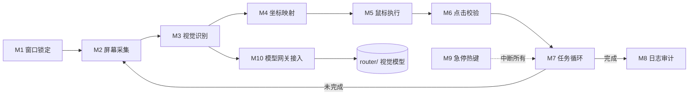

# Step 2 分析拆解书 — 桌面识别+自主点击应用

> 运行ID: `desktop-automation-001` | 步骤: Step 2 分析拆解 | 状态: 待两级门禁
> 编制: TopAgent (组织交付者) | 日期: 2026-08-09
> 输入: docs/desktop-automation/step1-requirements.md

## 1. 系统边界与上下文

```
┌────────────────────────────────────────────────────────────┐
│  用户 (CLI)                                                │
│    python main.py --app <窗口名> --task "..." --model ...   │
└──────────────┬─────────────────────────────────────────────┘
               ▼
┌────────────────────────────────────────────────────────────┐
│  TopAgent Desktop Automation CLI (本系统)                   │
│                                                             │
│  ┌──────────┐   ┌──────────┐   ┌──────────┐   ┌──────────┐ │
│  │①窗口锁定  │→  │②屏幕采集  │→  │③视觉识别  │→  │④坐标映射  │ │
│  └──────────┘   └──────────┘   └──────────┘   └────┬─────┘ │
│                                                    ▼        │
│  ┌──────────┐   ┌──────────┐   ┌──────────┐   ┌──────────┐ │
│  │⑧日志审计  │←  │⑦任务循环  │←  │⑥点击校验  │←  │⑤鼠标执行  │ │
│  └──────────┘   └──────────┘   └──────────┘   └──────────┘ │
│        ▲                    ┌──────────┐                    │
│        │                    │⑨急停热键  │ (ESC 全局监听)      │
│        └────────────────────└──────────┘                    │
└──────────────────────────────┬──────────────────────────────┘
                               │  route_and_execute (vision)
                               ▼
                   ┌──────────────────────┐
                   │  🔀 Model Router     │   router/ (已注册MCP)
                   │  router/server.py    │   vision → Claude 视觉模型
                   └──────────────────────┘
```

## 2. 功能模块分解

| # | 模块 | 职责 | 关键输入 | 关键输出 | 风险级 |
|---|------|------|---------|---------|--------|
| M1 | 窗口锁定 | 按窗口标题/进程名定位目标窗口，获得句柄与窗口矩形 | 窗口名参数 | `hwnd`, 窗口 rect (物理像素) | 低 |
| M2 | 屏幕采集 | 定时截取窗口区域画面 | 窗口 rect | PIL Image + 时间戳 | 低 |
| M3 | 视觉识别 | 截图 + 任务指令 → 视觉模型 → 结构化元素列表 | 截图, task, 上轮状态 | `[{element, description, rel_x, rel_y, confidence, action}]` | 中 |
| M4 | 坐标映射 | 模型相对坐标 → 屏幕绝对坐标（含 DPI/窗口缩放修正） | rel_x/y, 窗口 rect, DPI | 绝对坐标 (x,y) | 高 |
| M5 | 鼠标执行 | 移动+点击，支持单击/双击/拖拽 | 绝对坐标, action | 执行状态 | 中 |
| M6 | 点击校验 | 点击前验证坐标在窗口内、非红区；点击后快照对比验证效果 | 坐标, 窗口 rect, 点击前后截图 | 校验通过/失败 | 高 |
| M7 | 任务循环 | 循环执行直到任务完成/达到最大步数/无进展 | task, 每步结果 | 最终状态 | 中 |
| M8 | 日志审计 | 记录每步截图/识别结果/坐标/点击/校验，可回放 | 全部步骤数据 | JSONL 日志 + 截图目录 | 低 |
| M9 | 急停热键 | 全局监听 ESC 立即中止并释放鼠标 | 键盘事件 | 中止信号 | 低 |
| M10 | 模型网关接入 | 封装 router/ 调用（`route_and_execute` vision / dry_run 决策） | 截图, prompt | 模型返回结构化 JSON | 中 |

## 3. 关键技术决策点（留给 Step 4 架构师定夺）

| # | 决策点 | 候选方案 | 影响 |
|---|--------|---------|------|
| T1 | 视觉模型返回的坐标是**相对像素**还是**归一化比例** | 相对像素 (w×h内) vs 0~1 归一化 | 直接影响坐标映射精度；归一化更抗窗口尺寸变化 |
| T2 | 截图 → 模型 → 点击 的**循环节奏** | 固定间隔(如1s) vs 状态驱动(点击后等待反应) | 太快误判、太慢效率低 |
| T3 | 点击后的**效果验证**方式 | 前后截图 diff / 视觉模型二次确认 / 仅日志 | 决定可靠性上限 |
| T4 | 无进展/死循环**检测** | 连续N步坐标不变 / 截图hash不变 / 步数上限 | 决定安全兜底 |
| T5 | 模型调用走**MCP route_and_execute** 还是**直接CLI** | MCP工具 vs `python router/server.py --execute vision` | MCP更集成但需配置；CLI更可移植 |

## 4. 风险识别与缓解

| # | 风险 | 影响 | 概率 | 缓解措施 | 兜底 |
|---|------|------|------|---------|------|
| R1 | 视觉模型给出**幻觉/越界坐标** | 误点击 | 高 | M4 物理边界clamp + M6 窗口内校验 + NMS | ESC急停 |
| R2 | **DPI缩放**导致坐标偏移 | 点错元素 | 高 | 物理像素坐标 + 窗口句柄真实rect，禁用逻辑坐标 | 点击后快照对比 |
| R3 | **误点破坏性操作**（删除/提交/关闭） | 数据损失 | 中 | 首版：危险动作词黑名单（删除/关闭/确认删除...）拦截；坐标红区(标题栏/右上角关闭按钮)禁点 | ESC急停 |
| R4 | **任务循环失控**死循环 | 资源耗尽/反复误点 | 中 | M7 最大步数(默认50) + 无进展检测(T4) + 连续失败熔断 | ESC急停 |
| R5 | 视觉模型**推理慢/超时** | 效率低 | 中 | 超时重试 + 缓存相同截图识别结果 | 日志告警 |
| R6 | 目标窗口**最小化/移动/关闭** | 坐标失效 | 高 | 每步重新获取窗口rect；窗口关闭则终止任务 | 日志告警 |
| R7 | **API费用**不可控 | 成本超支 | 中 | 每步截图压缩(JPEG 60) + 步数上限 + 默认走本地可配置 | dry_run预览模式 |
| R8 | 多屏/负坐标**越界** | 点击到错误屏幕 | 低 | M4 屏幕虚拟桌面范围clamp | ESC急停 |

## 5. 模块依赖图（Mermaid）



## 6. 交付物清单（映射 Step 7 开发任务）

| 交付物 | 说明 | 对应模块 |
|--------|------|---------|
| `main.py` | CLI 入口 + 参数解析 + 循环调度 | M7, M9 |
| `window_manager.py` | 窗口锁定 + rect 获取 + DPI | M1, M4 |
| `screen_capture.py` | 截图封装（mss）+ 压缩 | M2 |
| `vision_client.py` | router/ 调用封装 + 结构化解析 + 重试 | M3, M10 |
| `coord_mapper.py` | 相对→绝对坐标 + clamp | M4 |
| `mouse_controller.py` | pyautogui 封装 + 点击 | M5 |
| `click_validator.py` | 点击前后校验 + 快照对比 | M6 |
| `logger.py` | JSONL 审计 + 截图保存 | M8 |
| `config.py` | 参数/阈值/黑名单配置 | 全局 |

---
✅ 本步骤产物 — 分析拆解书 v1.0
验证:  ⬜ 待验证 → 交 fact-check-agent 溯源验证 + qa-agent 质量审核
溯源:  [架构上下文] → CLAUDE.md Model Router 段 | [交付标准] → docs/desktop-automation/step1-requirements.md | [产品决策] → 用户 Step 1 澄清问卷（本会话 AskUserQuestion） | [运行状态] → `python orchestrator/top-agent-orchestrator.py status`（Step 2 当前步）