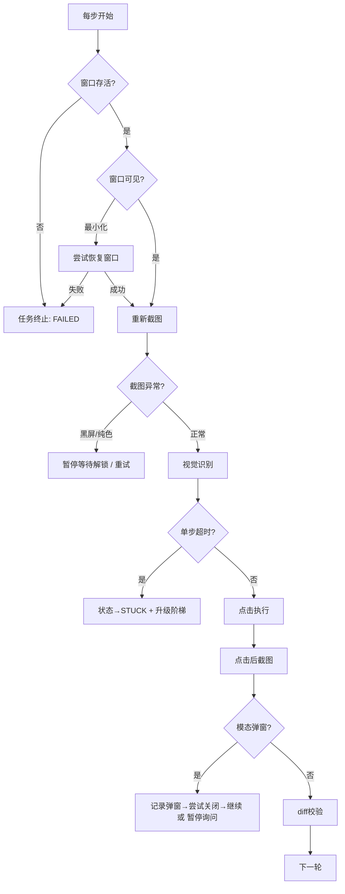
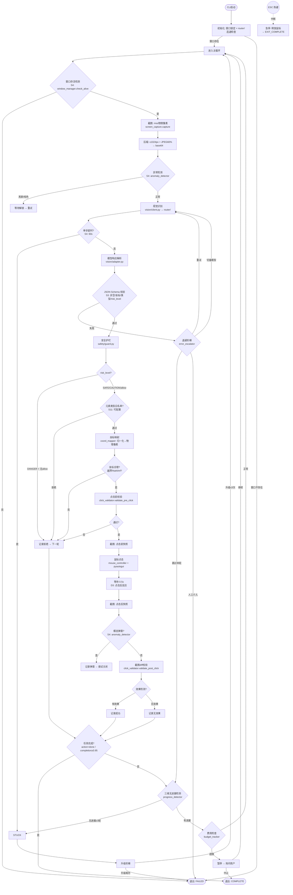
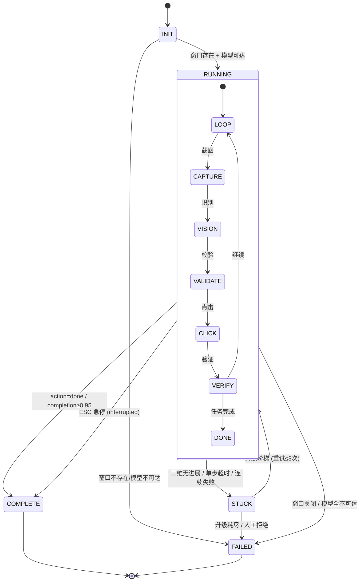

# Step 4 架构设计书 — 桌面识别+自主点击应用

> 运行ID: `desktop-automation-001` | 步骤: Step 4 架构设计 | 状态: 待两级门禁
> 编制: 架构师 Agent | 日期: 2026-08-09
> 输入: step1-requirements.md, step2-analysis.md, step3-research.md, step_3-qa.json, step_2-qa.json, step_3-fact-check.json
>
> 源材料版本:
> - `step1-requirements.md` v1.0 (用户确认)
> - `step2-analysis.md` v1.0 (QA 85分通过)
> - `step3-research.md` v1.1 (QA 85分通过, S1-S3修复)
> - `step_3-qa.json` — 遗留项 S4/S11/D5/CQ1/CQ2 本步骤强制处理
> - `step_2-qa.json` — 遗留项 E1/E2/E3 本步骤设计覆盖

---

## 一、六层架构总览

本项目为 Windows CLI 桌面自动化工具，采用如下六层划分（适配 CLI 工具特征，非传统 Web 六层）：

```
┌──────────────────────────────────────────────────────────────────┐
│  L1  CLI交互与生命周期层                                          │
│  main.py           ── 入口、参数解析、生命周期管理                  │
│  hotkey_listener   ── ESC 全局热键监听、急停信号广播               │
│  console_output    ── UTF-8 终端输出适配（中文/emoji）             │
├──────────────────────────────────────────────────────────────────┤
│  L2  任务编排与状态机层                                            │
│  task_loop         ── 主循环状态机 (running/stuck/complete/failed) │
│  error_escalator   ── 四阶退避阶梯 (重试→切备模型→跳过本轮→人工)    │
│  progress_detector ── 三维无进展检测 (坐标+hash+步数)               │
│  timeout_manager   ── 单步/全局超时控制                            │
├──────────────────────────────────────────────────────────────────┤
│  L3  视觉AI层                                                      │
│  vision_client     ── router/ 调用封装 + JSON schema 校验          │
│  model_adapter     ── 主备模型响应格式适配 (DashScope/SiliconFlow) │
│  prompt_builder    ── 结构化 Prompt 模板 (含 risk_level 指令)      │
│  coord_evaluator   ── D5 坐标精度评估协议执行器                     │
├──────────────────────────────────────────────────────────────────┤
│  L4  坐标与执行控制层                                              │
│  coord_mapper      ── 归一化→物理像素 + DPI补偿 + 边界clamp        │
│  mouse_controller  ── pyautogui 封装 (移动+点击+FAILSAFE)          │
│  click_validator   ── 点击前坐标校验 + 点击后截图diff验证           │
├──────────────────────────────────────────────────────────────────┤
│  L5  平台采集层                                                     │
│  window_manager    ── 窗口句柄定位 + rect获取 + 存在性检测          │
│  screen_capture    ── mss 物理像素截图 + Pillow压缩 + base64       │
│  anomaly_detector  ── S4: 模态弹窗检测 + 锁屏/黑屏检测             │
├──────────────────────────────────────────────────────────────────┤
│  L6  安全与基础设施层                                              │
│  safety_guard      ── 危险评级 + 元素白名单 + 区域黑名单            │
│  logger            ── JSONL 审计日志 + 截图存档                    │
│  config            ── 全局配置/阈值/黑名单/用户参数                 │
│  budget_tracker    ── API 费用预估/累计/超限暂停                   │
└──────────────────────────────────────────────────────────────────┘
```

### 1.1 层间通信协议

| 方向 | 接口 | 数据格式 | 说明 |
|------|------|---------|------|
| L1 → L2 | 命令行参数 | `argparse.Namespace` | 解析后传入 task_loop |
| L2 → L3 | `vision_client.analyze(screenshot, task, state)` | `VisionRequest` dict | 任务循环调用视觉识别 |
| L2 → L4 | `coord_mapper.map(rel_coords)` / `mouse_controller.click(x,y)` | 坐标 tuple / `ClickAction` | 识别结果驱动执行 |
| L2 → L5 | `window_manager.get_rect()` / `screen_capture.capture(rect)` | `WindowRect` / PIL Image | 每轮循环获取最新窗口状态 |
| L2 → L6 | `safety_guard.check(action)` / `logger.log(entry)` | `SafetyVerdict` / `LogEntry` | 每步安全校验+日志记录 |
| L3 → L4 (旁路) | `model_adapter.parse(raw_response)` → `coord_mapper` | 结构化元素列表 | 视觉结果解析后直送坐标层 |
| L5 → L4 (旁路) | `window_manager.get_rect()` → `click_validator` | `WindowRect` | 坐标边界校验依据 |
| 全层 → L6 | 异常/费用/状态事件 | 各层日志事件 | 横切关注点 |

溯源: [六层模型] → 传统六层架构 (展示→应用→业务→数据→基础设施→安全) 按项目特征适配为 CLI/编排/AI/控制/采集/安全 | [模块映射] → step2-analysis.md §2 (M1-M10) | [层间接口设计] → step3-research.md 技术栈 pipeline (L10-22) | [router/ 集成模式] → router/server.py L79-115

验证: ⬜ 待验证 → 交 QA + fact-check 两级门禁

---

## 二、技术选型对比表

每项技术均对比至少 3 个候选方案，6 维加权评分 (功能适配 30% + 稳定性 25% + 社区活跃 15% + 性能 10% + 易用性 10% + 项目约束兼容 10%)。

### 2.1 截屏库

| 方案 | 功能适配 | 稳定性 | 社区 | 性能 | 易用 | 约束 | 总分 | 结论 |
|------|:--:|:--:|:--:|:--:|:--:|:--:|:--:|------|
| **mss** | 9 | 9 | 8 | 9 | 9 | 9 | **8.85** | **推荐**: 物理像素、无 DPI 歧义、C 扩展快 |
| PyGetWindow | 5 | 7 | 6 | 6 | 8 | 7 | 6.2 | 备选: 窗口定位可用，截屏弱 |
| PIL.ImageGrab | 7 | 7 | 9 | 5 | 9 | 4 | 6.85 | 不推荐: Windows 下 DPI 缩放导致坐标偏移 (已知bug) |
| DXcam | 8 | 6 | 5 | 9 | 6 | 6 | 6.9 | 不推荐: 社区小(232 star)，Windows 11 兼容性未验证 |

溯源: [mss DPI 警告] → https://github.com/BoboTiG/python-mss README | [PIL DPI bug] → https://github.com/python-pillow/Pillow/issues (多起 DPI 报告) | [DXcam] → https://github.com/ra1nty/DXcam

### 2.2 鼠标控制

| 方案 | 功能适配 | 稳定性 | 社区 | 性能 | 易用 | 约束 | 总分 | 结论 |
|------|:--:|:--:|:--:|:--:|:--:|:--:|:--:|------|
| **pyautogui** | 9 | 9 | 9 | 8 | 9 | 9 | **8.9** | **推荐**: FAILSAFE 内建、跨平台、生态成熟 |
| pynput | 8 | 8 | 8 | 8 | 7 | 8 | 7.95 | 备选: 更底层的事件监听，但无 FAILSAFE |
| win32api (直接SendInput) | 9 | 9 | 9 | 9 | 4 | 9 | 8.25 | 不推荐: 无 FAILSAFE、需手写坐标换算、开发量大 |
| pywinauto | 7 | 7 | 7 | 7 | 6 | 7 | 6.85 | 不推荐: 重(依赖 UIA)、不适合纯视觉方案 |

溯源: [pyautogui FAILSAFE] → https://github.com/asweigart/pyautogui/issues/663 | [pyautogui DPI] → https://pyautogui.readthedocs.io/

### 2.3 窗口管理

| 方案 | 功能适配 | 稳定性 | 社区 | 性能 | 易用 | 约束 | 总分 | 结论 |
|------|:--:|:--:|:--:|:--:|:--:|:--:|:--:|------|
| **win32gui (pywin32)** | 9 | 9 | 9 | 9 | 7 | 9 | **8.8** | **推荐**: Windows 原生 API、句柄/rect/进程名 |
| pygetwindow | 7 | 7 | 7 | 7 | 9 | 8 | 7.3 | 备选: 跨平台但功能弱，窗口查找不可靠 |
| uiautomation | 9 | 8 | 7 | 6 | 6 | 7 | 7.55 | 备选: UIA 树精确但依赖目标应用支持 UIA |
| ctypes 直调 user32 | 9 | 9 | - | 9 | 3 | 9 | 7.0 | 不推荐: 手写 FFI 维护成本高，pywin32 已封装 |

溯源: [pywin32] → https://github.com/mhammond/pywin32 | [uiautomation] → https://github.com/yinkaisheng/Python-UIAutomation-for-Windows

### 2.4 视觉模型调用方式

| 方案 | 功能适配 | 稳定性 | 社区 | 性能 | 易用 | 约束 | 总分 | 结论 |
|------|:--:|:--:|:--:|:--:|:--:|:--:|:--:|------|
| **router/ CLI (`--execute vision`)** | 9 | 9 | - | 8 | 8 | 9 | **8.75** | **推荐**: 符合 D6 项目约束、主备自动切换、dry_run 安全 |
| router/ MCP (`route_and_execute`) | 7 | 8 | - | 6 | 9 | 9 | 7.55 | 备选: 集成度高但依赖 Claude Code MCP 环境，独立 CLI 部署不适用 |
| Anthropic API 直连 | 9 | 9 | 9 | 9 | 7 | 3 | 7.75 | 备选: 坐标精度最高但违反 D6、需额外 API Key、未列入 router |
| DashScope SDK 直连 | 8 | 8 | 7 | 8 | 7 | 5 | 7.3 | 不推荐: 绕过 router 失去故障转移、需独立维护 API Key |

**D1 裁决**: 主方案走 `router/ CLI` (python router/server.py --execute vision)，坐标精度实测评估后再决定是否启用 Anthropic 备选。详见 ADR-001、ADR-003。

溯源: [router/ CLI 用法] → router/server.py L13-16 | [vision 路由] → router/config.yaml L55-58 | [D6 约束] → step1-requirements.md §4.D6

### 2.5 日志框架

| 方案 | 功能适配 | 稳定性 | 社区 | 性能 | 易用 | 约束 | 总分 | 结论 |
|------|:--:|:--:|:--:|:--:|:--:|:--:|:--:|------|
| **Python logging + 自定义 JSONL handler** | 9 | 9 | 9 | 9 | 8 | 9 | **8.9** | **推荐**: 标准库零依赖、JSONL 格式可 grep/jq 分析 |
| loguru | 9 | 8 | 8 | 9 | 9 | 9 | 8.7 | 备选: 更友好的 API，但与 JSONL 自定义输出需额外配置 |
| structlog | 8 | 7 | 6 | 8 | 7 | 9 | 7.55 | 不推荐: 社区较小、学习成本高 |

### 2.6 全局热键

| 方案 | 功能适配 | 稳定性 | 社区 | 性能 | 易用 | 约束 | 总分 | 结论 |
|------|:--:|:--:|:--:|:--:|:--:|:--:|:--:|------|
| **keyboard (boppreh)** | 9 | 8 | 9 | 8 | 9 | 9 | **8.75** | **推荐**: `keyboard.add_hotkey('esc', callback)` 一行注册 |
| pynput | 8 | 8 | 8 | 8 | 7 | 8 | 7.95 | 备选: 也可做热键但 API 更底层 |
| win32api RegisterHotKey | 9 | 9 | - | 9 | 4 | 9 | 7.25 | 不推荐: 手写 Windows 消息循环、与 CLI 主线程冲突 |

溯源: [keyboard] → https://github.com/boppreh/keyboard | [Clacky Esc 热键] → https://github.com/Raynan00/clacky

---

## 三、目录结构与模块划分

```
desktop-automation/
├── README.md                    # 项目说明 + 快速开始
├── requirements.txt             # Python 依赖
│
├── main.py                      # [L1] CLI 入口: argparse + 生命周期管理 + 信号处理
│
├── config.py                    # [L6] 全局配置: 阈值/黑名单/预算/超时/模型参数
│
├── hotkey/                      # [L1] 热键子系统
│   ├── __init__.py
│   └── listener.py              # ESC 全局热键注册 + 急停信号 Event 广播
│
├── loop/                        # [L2] 任务编排子系统
│   ├── __init__.py
│   ├── task_loop.py             # 主循环状态机 (running/stuck/complete/failed)
│   ├── error_escalator.py       # 四阶退避: 重试→切备模型→跳过本轮→人工介入
│   ├── progress_detector.py     # 三维无进展检测: 坐标+截图hash+步数
│   └── timeout_manager.py       # 单步超时 + 全局超时 + stuck 判定
│
├── vision/                      # [L3] 视觉AI子系统
│   ├── __init__.py
│   ├── client.py                # router/ CLI 调用封装 + 响应JSON schema 校验
│   ├── adapter.py               # 主备模型响应格式适配器 (DashScope/SiliconFlow)
│   ├── prompt_builder.py        # 结构化 Prompt 模板 (任务指令+元素清单+risk_level)
│   └── coord_evaluator.py       # D5 坐标精度评估协议执行器
│
├── control/                     # [L4] 坐标与执行控制子系统
│   ├── __init__.py
│   ├── coord_mapper.py          # 归一化(0-1)→物理像素 + DPI补偿 + 边界clamp
│   ├── mouse_controller.py      # pyautogui 封装: 移动+单击+双击+FAILSAFE
│   └── click_validator.py       # 点击前坐标校验 + 点击后截图diff验证
│
├── platform/                    # [L5] 平台采集子系统
│   ├── __init__.py
│   ├── window_manager.py        # win32gui 封装: 窗口查找+rect获取+存在性检测
│   ├── screen_capture.py        # mss 截图 + Pillow压缩+resize + base64编码
│   └── anomaly_detector.py      # S4: 模态弹窗检测 + 锁屏/黑屏/纯色检测
│
├── safety/                      # [L6] 安全护栏子系统
│   ├── __init__.py
│   ├── guard.py                 # 统一安全入口: 危险评级+元素白名单+区域黑名单
│   └── budget_tracker.py        # API 费用预估/累计/超限暂停询问
│
├── log/                         # [L6] 日志审计子系统
│   ├── __init__.py
│   └── logger.py                # JSONL 审计日志 + 截图目录管理 + token/费用记录
│
├── tests/                       # 测试目录
│   ├── test_coord_mapper.py
│   ├── test_click_validator.py
│   ├── test_anomaly_detector.py
│   └── fixtures/                # 测试用截图 + ground truth 坐标
│       └── coord_eval/          # D5 坐标精度测评集 (5图×3坐标=15点)
│
└── logs/                        # 运行时产出 (gitignore)
    ├── sessions/                # 按时间戳命名的会话目录
    │   └── 20260809-120000/
    │       ├── audit.jsonl      # 审计日志
    │       └── screenshots/     # 截图存档
    └── coord_eval_results/      # 坐标精度评估结果
```

### 3.1 模块 → 需求模块映射

| 文件 | 映射 | 说明 |
|------|------|------|
| `main.py` | M7, M9 | 任务循环入口 + 急停信号注册 |
| `hotkey/listener.py` | M9 | ESC 急停热键 |
| `loop/task_loop.py` | M7 | 核心循环状态机 |
| `loop/error_escalator.py` | M7 | 错误退避阶梯 (S3 QA 修复) |
| `loop/progress_detector.py` | M7 | 无进展/死循环检测 (T7 陷阱) |
| `loop/timeout_manager.py` | M7 | S4 单步超时 + 全局超时 |
| `vision/client.py` | M3, M10 | router/ 视觉调用 |
| `vision/adapter.py` | M3 | 主备模型适配 (T3 陷阱) |
| `vision/prompt_builder.py` | M3 | Prompt 工程 + risk_level |
| `vision/coord_evaluator.py` | D5 | 坐标精度评估 |
| `control/coord_mapper.py` | M4 | 坐标映射 + clamp |
| `control/mouse_controller.py` | M5 | 鼠标执行 |
| `control/click_validator.py` | M6 | 点击校验 |
| `platform/window_manager.py` | M1, M4 | 窗口锁定 + rect + 存在性检测 |
| `platform/screen_capture.py` | M2 | 截图 + 压缩 |
| `platform/anomaly_detector.py` | S4, E2 | 模态弹窗/锁屏/黑屏检测 |
| `safety/guard.py` | M6 | 危险评级 + 白名单 + 黑名单 |
| `safety/budget_tracker.py` | M7 | 费用控制 (S2 QA 修复) |
| `log/logger.py` | M8 | 审计日志 |
| `config.py` | 全局 | 参数/阈值/配置 |

溯源: [模块清单] → step2-analysis.md §2 (M1-M10) | [交付物清单] → step2-analysis.md §6 | [QA 修复关联] → step_3-qa.json (S1-S3 修复项)

---

## 四、关键接口规范

### 4.1 vision_client 接口

#### 4.1.1 输入: VisionRequest

```json
{
  "$schema": "VisionRequest v1.0",
  "image_base64": "string (JPEG base64, ≤1024px宽, JPEG60%)",
  "task": "string (用户任务指令, 如 '点击计算器上的 = 按钮')",
  "context": {
    "step": "int (当前步数, 从1开始)",
    "max_steps": "int (最大步数)",
    "previous_actions": ["string (前几步的动作描述)"],
    "previous_success": "bool (上一步是否校验通过)"
  },
  "options": {
    "relax_type_check": "bool (默认false, 为true时放宽元素类型白名单)",
    "require_risk_level": "bool (默认true, 要求模型输出risk_level)"
  }
}
```

#### 4.1.2 输出: VisionResponse

```json
{
  "$schema": "VisionResponse v1.0",
  "elements": [
    {
      "element": "string (元素描述, 如 '等号按钮')",
      "description": "string (元素在界面中的外观描述)",
      "type": "string (button|link|checkbox|menu-item|input|text|icon|other)",
      "rel_x": "float (归一化相对x坐标, 0.0~1.0)",
      "rel_y": "float (归一化相对y坐标, 0.0~1.0)",
      "confidence": "float (模型自信度, 0.0~1.0)",
      "action": "string (click|double_click|type|scroll|hover|wait|done)",
      "risk_level": "string (SAFE|CAUTION|DANGER)",
      "reasoning": "string (模型决策理由, 可选)"
    }
  ],
  "status": "string (done|in_progress|stuck|error)",
  "summaries": {
    "scene_description": "string (当前界面整体描述)",
    "completion_estimate": "float (任务完成进度估计 0.0~1.0)"
  },
  "model_info": {
    "platform": "string (实际使用的平台, 如 dashscope)",
    "model": "string (实际使用的模型, 如 qwen3-vl-plus)"
  }
}
```

#### 4.1.3 Schema 校验规则

| 校验项 | 规则 | 失败动作 |
|--------|------|---------|
| elements 非空 | `len(elements) > 0` | 若 step≥2 且连续空 → 退避阶梯 |
| 必需字段存在 | `element`, `rel_x`, `rel_y`, `action` 存在且非 null | 剔除该 element，若全部剔除 → 退避 |
| 坐标范围 | `0.0 ≤ rel_x ≤ 1.0` 且 `0.0 ≤ rel_y ≤ 1.0` | 边界 clamp + 日志告警 |
| 坐标非 NaN/Inf | `math.isfinite(rel_x) and math.isfinite(rel_y)` | 剔除该 element (S3 修复) |
| confidence 范围 | `0.0 ≤ confidence ≤ 1.0` | clamp |
| action 合法值 | `click|double_click|type|scroll|hover|wait|done` | 默认降级为 `click` |
| risk_level 合法值 | `SAFE|CAUTION|DANGER` | 缺失时默认 `CAUTION` |

溯源: [Schema 设计依据] → step3-research.md §2.3 模型返回格式 | [S3 修复 NaN 校验] → step_3-qa.json (S3 fix) | [router/ 响应格式] → router/providers.py 各平台适配器

### 4.2 coord_mapper 接口

```python
class CoordMapper:
    """归一化坐标 → 屏幕物理像素转换器"""

    def map(
        self,
        rel_x: float,       # 归一化 x (0.0~1.0), 相对窗口截图
        rel_y: float,       # 归一化 y (0.0~1.0)
        window_rect: WindowRect,  # 目标窗口物理像素矩形
        dpi_scale: float = 1.0,   # DPI 缩放因子 (默认不缩放)
    ) -> tuple[int, int]:
        """
        Returns: (screen_x, screen_y) 物理像素整数坐标

        Raises:
            CoordinateOutOfBoundsError: 映射后坐标超出屏幕虚拟桌面
            InvalidCoordinateError: 输入 NaN/Inf/越界
        """
        ...

class WindowRect(NamedTuple):
    left: int      # 窗口左上角屏幕物理 x
    top: int       # 窗口左上角屏幕物理 y
    width: int     # 窗口物理宽度
    height: int    # 窗口物理高度
```

**映射公式**: `screen_x = window_rect.left + int(rel_x * window_rect.width)`; `screen_y = window_rect.top + int(rel_y * window_rect.height)`

**Clamp 策略**: 映射后坐标 clamp 到 `[window_rect.left, window_rect.left+width]` × `[window_rect.top, window_rect.top+height]`；再 clamp 到虚拟桌面边界。

溯源: [适配器模式] → step3-research.md T3 陷阱 (主备模型坐标格式差异) | [物理像素策略] → step3-research.md §2.1 对比表结论 | [Claude Computer Use 缩放参考] → https://platform.claude.com/docs/en/docs/agents-and-tools/computer-use

### 4.3 click_validator 接口

```python
class ClickValidator:
    """点击前后校验器"""

    def validate_pre_click(
        self,
        screen_coord: tuple[int, int],  # 待点击屏幕坐标
        window_rect: WindowRect,         # 目标窗口矩形
        safety_verdict: SafetyVerdict,   # L6 安全裁决结果
    ) -> PreClickResult:
        """
        前置校验:
        1. 坐标在窗口范围内?
        2. 坐标在虚拟桌面内?
        3. 坐标不在危险区域 (标题栏关闭按钮/任务栏)?
        4. 安全裁决通过 (非 DANGER 或 --allow-dangerous)?
        
        Returns: PreClickResult(ok=True/False, reason=str, risk=str)
        """
        ...

    def validate_post_click(
        self,
        screenshot_before: Image,     # 点击前截图
        screenshot_after: Image,      # 点击后截图 (等待 0.5s 后获取)
        threshold: float = 0.02,      # diff 阈值 (2% 像素变化视为有效)
    ) -> PostClickResult:
        """
        后置校验:
        1. 截图 diff 像素变化率 > threshold → 点击生效
        2. 截图 diff 像素变化率 = 0 → 可能未点到/界面冻结
        3. 截图全黑/纯色 → 异常 (锁屏/应用崩溃)
        
        Returns: PostClickResult(effect_detected=bool, change_ratio=float, anomaly=str|None)
        """
        ...
```

溯源: [D3 循环节奏] → step3-research.md D3 (点击后等待0.5-1s) | [D4 效果验证] → step3-research.md D4 (截图diff为主) | [S4 异常检测] → step_3-qa.json S4-DEFER

### 4.4 任务循环状态机

```
状态枚举: INIT → RUNNING → { COMPLETE | FAILED | STUCK }
                                          ↓
                                     可恢复为 RUNNING (升级后重试)
```

```
┌──────┐  启动   ┌─────────┐  目标达成  ┌──────────┐
│ INIT │───────→│ RUNNING │──────────→│ COMPLETE  │
└──────┘        └────┬────┘            └──────────┘
                     │
          ┌──────────┼──────────┐
          ▼          ▼          ▼
     ┌────────┐ ┌────────┐ ┌────────┐
     │ STUCK  │ │ FAILED │ │ ESC键  │
     │(无进展) │ │(异常)  │ │(急停)  │
     └───┬────┘ └────────┘ └───┬────┘
         │    升级阶梯重试      │
         └────→ RUNNING ───────┘→ COMPLETE (task_status=interrupted)
```

**状态转换规则**:

| 当前状态 | 触发事件 | 目标状态 | 条件 |
|---------|---------|---------|------|
| INIT | 参数校验通过 | RUNNING | 窗口存在、模型可达 |
| INIT | 窗口不存在 | FAILED | 报告并退出 |
| RUNNING | `action=done` 或 `completion_estimate≥0.95` | COMPLETE | — |
| RUNNING | 三维无进展检测触发 | STUCK | 坐标不变 AND hash不变 AND 连续N步 |
| RUNNING | 单步超时 (60s) | STUCK | S4 超时机制 |
| RUNNING | 不可恢复错误 (窗口关闭/模型全部不可达/连续失败) | FAILED | — |
| RUNNING | ESC 热键按下 | COMPLETE | task_status=interrupted |
| STUCK | 升级阶梯 (重试→切模型→跳过→询问) | RUNNING | 升级次数 ≤3 |
| STUCK | 升级耗尽 | FAILED | 升级次数 >3 或人工拒绝放行 |

溯源: [状态机设计] → step2-analysis.md §5 Mermaid (M2→M3→...→M7 循环) | [T7 无进展检测] → step3-research.md §2.2 T7 | [升级阶梯] → git f40c2ac 编排器循环防护

---

## 五、ADR 架构决策记录

### ADR-001: 视觉模型调用走 router/ 网关 (CLI 模式)

| 属性 | 内容 |
|------|------|
| **编号** | ADR-001 |
| **状态** | 已接受 |
| **日期** | 2026-08-09 |
| **决策者** | 架构师 Agent (waiting user confirmation) |

**背景**:
项目需求 D6 明确要求"走 `router/` 模型网关，不硬编码 API"。router/ 已为 `vision` 任务类型配置了主备路由链 (`dashscope/qwen3-vl-plus` → `siliconflow/Qwen/Qwen3-VL-32B-Instruct`)，并支持 dry_run 安全预览模式。同时 Anthropic Computer Use API 在坐标格式清晰度（官方 `[x,y]` 整数像素坐标+安全护栏文档）方面具有已知优势，但需独立 API Key 且未列入 router/ 路由表。

**决策**:
- **Phase 1 MVP 阶段**: 100% 走 `router/` CLI 模式 (`python router/server.py --execute vision --image screenshot.jpg --prompt "..."`)
- **触发 Anthropic 备选评估的条件** (ADR-003 决策门): qwen3-vl-plus 在坐标精度测评中 `<10px 准确率 < 80%`，且 `平均像素误差 > 15px`
- 若触发备选，向 router/config.yaml `vision` 路由添加 `anthropic` 作为第2 fallback 或平行主模型

**正面后果**:
- 完全符合 D6 项目约束
- 享受 router/ 的故障转移能力（dashscope 不可用→自动切 siliconflow）
- dry_run 模式可在开发阶段零费用验证 Prompt
- 无需额外管理 Anthropic API Key

**负面后果**:
- qwen3-vl-plus 的坐标精度未经实际验证（知识库空白，见 step3-research.md §1.3）
- 如果实测精度不足，需要在 Phase 1 内完成 Anthropic 接入（增加约 1-2 天工作量）
- router/ CLI 每次调用启动独立 Python 进程，相比直连 SDK 多约 0.5-1s 进程启动开销（MVP 可接受）

**备选方案**:
| 方案 | 否决原因 |
|------|---------|
| Anthropic API 直连 | 违反 D6、需额外 Key、未列入 router |
| MCP `route_and_execute` | 依赖 Claude Code 环境，独立 CLI 部署不可用 |
| DashScope SDK 直连 | 绕过 router 失去故障转移 |

溯源: [D6 约束] → step1-requirements.md §4.D6 | [router/ vision 路由] → router/config.yaml L55-58 core-read | [Anthropic Computer Use 文档] → https://platform.claude.com/docs/en/docs/agents-and-tools/computer-use | [知识库坐标精度空白] → step3-research.md §2.3 注意+ step_3-memory-learning.md §1.3

---

### ADR-002: 归一化坐标格式 (0-1) + 适配器模式

| 属性 | 内容 |
|------|------|
| **编号** | ADR-002 |
| **状态** | 已接受 |
| **日期** | 2026-08-09 |
| **决策者** | 架构师 Agent (waiting user confirmation) |

**背景**:
视觉模型可返回两种坐标格式：(A) 归一化比例 0-1（如 OmniParser、qwen3-vl 常见），或 (B) 绝对像素坐标（如 Anthropic Computer Use `[x,y]` 整数）。主模型 qwen3-vl-plus 和备模型 Qwen3-VL-32B 可能返回不同格式，且未来可能引入 Anthropic 作为第三模型。Step3 研究结论倾向归一化（更抗窗口尺寸变化），QA 指出需适配器模式统一处理 (step_2-qa.json E3)。

**决策**:
- 统一内部使用**归一化坐标 (0-1 float)**，`vision/adapter.py` 作为适配器层为每个模型平台提供独立的响应解析器
- `control/coord_mapper.py` 输入归一化坐标，输出物理像素
- 适配器职责: 将各模型的原始坐标格式标准化为 `{rel_x, rel_y}` 归一化格式
- 若未来引入 Anthropic: 适配器将其 `[x,y]` 整数像素除以 `display_width_px/display_height_px` 转为归一化

**正面后果**:
- 归一化坐标抗窗口尺寸变化（窗口缩放/移动不影响坐标语义）
- 适配器模式使主备模型切换对下游透明（L4 坐标层不感知模型差异）
- 未来添加新模型只需新增一个适配器

**负面后果**:
- 需要额外维护适配器层（但每个适配器约 30-50 行代码）
- 归一化→物理像素转换依赖窗口 rect 准确性（若窗口 rect 获取失败则无法转换）

**备选方案**:
| 方案 | 否决原因 |
|------|---------|
| 绝对像素坐标 | 窗口尺寸变化时坐标失效；主备模型格式不统一 |
| 混合模式 (模型返回什么用什么) | 下游 L4 需感知模型差异，增加耦合 |

溯源: [坐标格式对比] → step3-research.md §2.1 对比表 | [OmniParser 归一化] → https://huggingface.co/microsoft/OmniParser/discussions/36 | [Claude Computer Use 像素] → https://platform.claude.com/docs/en/docs/agents-and-tools/computer-use | [E3 适配器建议] → step_2-qa.json E3

---

### ADR-003: 坐标精度决策门 — qwen3-vl 不及格则启用 Anthropic

| 属性 | 内容 |
|------|------|
| **编号** | ADR-003 |
| **状态** | 已接受 |
| **日期** | 2026-08-09 |
| **决策者** | 架构师 Agent (waiting user confirmation) |

**背景**:
知识库中没有任何视觉模型的坐标输出精度评分 (step_3-memory-learning.md §1.3)。qwen3-vl-plus 虽多模态评分 95/100，但这是综合视觉理解能力，不特指 UI 元素定位精度。QA 要求 D5 补充最小验证协议 (step_3-qa.json D5-PROTOCOL)。Anthropic Computer Use API 因专门为桌面自动化设计，理论上坐标精度更可靠，但缺乏实测对比数据。

**决策**:
建立坐标精度决策门，具体如下：

**第一阶段: qwen3-vl-plus 坐标精度实测 (Phase 1 开发早期执行)**

| 参数 | 值 |
|------|-----|
| 测试集规模 | 5 张代表性 Windows 应用截图 (计算器/记事本/文件资源管理器/浏览器/设置) |
| 每张标注点数 | 3 个坐标点 (共 15 个 ground truth 点) |
| 标注方式 | 人工用画图工具获取像素坐标 → 转为归一化坐标 (0-1) |
| 评估指标 | ① 平均像素误差 (MAPE): 预测坐标 vs 标注坐标的欧氏距离均值 |
|  | ② <10px 准确率: 像素误差 <10px 的点数 / 总点数 |
|  | ③ <20px 准确率: 像素误差 <20px 的点数 / 总点数 |
| 通过阈值 | <10px 准确率 ≥ 80% (15点中≥12点) AND 平均误差 ≤ 12px AND 无越界/NaN 输出 |
| 执行者 | `vision/coord_evaluator.py` → 读取 `tests/fixtures/coord_eval/` → 调模型 → 对比 → 输出报告 |

**第二阶段: 决策分支**

```
qwen3-vl-plus 测评结果
    │
    ├── 通过 (<10px 准确率≥80%, 平均误差≤12px)
    │       └──→ 继续使用 router/ qwen3-vl-plus 作为唯一主模型
    │            记录评分到 memory/model-capability-matrix.md
    │
    └── 未通过
            └──→ 评估 Anthropic Computer Use 作为备选
                  ├── 若 Anthropic 通过评测 → 添加 anthropic 到 router vision fallback
                  └── 若 Anthropic 也未通过 → 降级策略: 坐标 + 额外安全 margin (15px)
                                             + 用户确认模式开关
```

**正面后果**:
- 用数据而非猜测做技术决策
- 实测结果回填知识库，填补当前空白
- 为未来项目提供可复用的坐标精度基准

**负面后果**:
- 测试集构建需约 1-2 小时人工标注
- 若需接入 Anthropic 则增加开发工作量

**备选方案**:
| 方案 | 否决原因 |
|------|---------|
| 不做实测直接假定 qwen3-vl 精度够用 | 知识库空白无法支撑假设；QA 要求 D5 具体化 |
| 默认同时接入 Anthropic | 违反 D6、过度设计 (YAGNI 原则) |

溯源: [知识库坐标精度空白] → step_3-memory-learning.md §1.3 | [D5 协议要求] → step_3-qa.json D5-PROTOCOL | [Anthropic Computer Use 坐标格式] → https://platform.claude.com/docs/en/docs/agents-and-tools/computer-use

---

## 六、S4/S11/D5 专项设计

### 6.1 S4: 应用崩溃/模态弹窗异常处理

#### 6.1.1 窗口存在性检测

```python
# platform/window_manager.py
class WindowManager:
    def check_alive(self) -> bool:
        """每步循环前校验目标窗口/进程是否存活"""
        # 1. IsWindow(hwnd) → 句柄有效?
        # 2. GetWindowThreadProcessId → 进程ID
        # 3. OpenProcess + GetExitCodeProcess → 进程仍在运行?
        # 返回: True=正常 / False=窗口关闭/崩溃
    
    def detect_window_state(self) -> str:
        """检测窗口状态"""
        # IsIconic → 最小化
        # IsWindowVisible → 不可见?
        # GetWindowRect → 尺寸异常 (0×0 / 负值)?
        # 返回: normal | minimized | invisible | destroyed
```

**异常处理流程**:
```
窗口检测结果:
  - normal → 继续循环
  - minimized → 尝试恢复 (ShowWindow SW_RESTORE) → 等1s → 重新截图
  - invisible/destroyed → 任务终止 → FAILED (窗口已关闭)
```

#### 6.1.2 模态弹窗检测

```python
# platform/anomaly_detector.py
class AnomalyDetector:
    def detect_modal_dialog(self, screenshot: Image) -> ModalInfo | None:
        """
        检测模态弹窗 (如错误提示/确认对话框):
        
        策略 (多信号融合):
        1. 边缘高对比度矩形检测: 
           - 截图中心区域 (避开任务栏) 检测突然出现的矩形框
           - 弹窗特征: 外框颜色与背景高对比 + 内部颜色较浅/一致
        2. 截图整体变化率检测:
           - 若当前截图与上轮截图 diff > 30% (非点击导致) → 可能为弹窗
        3. 小窗口检测:
           - 弹窗通常是小于主窗口的独立窗口
           - FindWindow 检查是否有新的顶层窗口出现
        
        返回: ModalInfo(type="error|warning|info|unknown", rect=..., confidence=float)
              或 None (未检测到弹窗)
        """
        ...

    def detect_screen_anomaly(self, screenshot: Image) -> str | None:
        """
        检测截图异常:
        - 全黑: stddev≈0 且 mean<5 → "black_screen" (锁屏/屏保/S4:应用崩溃黑屏)
        - 纯色: stddev≈0 且 mean≥5 → "solid_color"
        - 严重模糊/花屏: 拉普拉斯方差<阈值 → "blurry"
        返回: 异常类型字符串 或 None
        """
        ...
```

#### 6.1.3 单步超时机制

```python
# loop/timeout_manager.py
class TimeoutManager:
    STEP_TIMEOUT = 60.0        # 单步超时 (视觉模型推理)
    CLICK_TIMEOUT = 5.0        # 点击执行超时 (鼠标移动+点击)
    POST_CLICK_WAIT = 0.5      # 点击后等待 (截图diff前)
    GLOBAL_TIMEOUT = 600.0     # 全局超时 (10分钟, 防止无限运行)
    STUCK_THRESHOLD = 3        # 连续N步无进展视为 stuck

    def guard_step(self, step_fn, step_num: int) -> StepResult:
        """单步超时守卫: 超时→STUCK; 连续3次STUCK→FAILED"""
        ...

    def should_abort(self, elapsed: float) -> bool:
        """全局超时检查"""
        ...
```

**S4 综合流程 (Mermaid)**:



溯源: [S4 要求] → step_3-qa.json S4-DEFER (窗口存在性检测+模态弹窗检测+单步超时) | [锁屏检测 E2] → step_2-qa.json E2 + step_3-memory-learning.md T6 | [UIPI 检测 E1] → step_2-qa.json E1 + step_3-memory-learning.md T5

### 6.2 S11: 元素类型白名单可配置性

**问题**: 元素类型白名单 `button|link|checkbox|menu-item|input` 对全自主模式的自定义 UI / Canvas 应用可能过度限制。

**设计**:

```python
# config.py 默认配置
ELEMENT_TYPE_WHITELIST = [
    "button", "link", "checkbox", "menu-item", 
    "input", "text", "icon", "tab", "dropdown",
    "slider", "toggle", "radio", "toolbar-item", "other"
]  # 全自主模式默认允许的完整列表 (含 other 兜底)

# CLI 参数
parser.add_argument(
    "--relax-type-check",
    action="store_true",
    default=False,
    help="放宽元素类型白名单：允许模型返回的任意类型（含 other），仅拒绝 DANGER+空类型"
)
parser.add_argument(
    "--strict-type-check",
    action="store_true",
    default=False,
    help="严格类型检查：仅允许 button|link|checkbox|menu-item|input"
)
parser.add_argument(
    "--allowed-types",
    nargs="+",
    default=None,
    help="自定义允许的元素类型列表，覆盖默认白名单 (如 --allowed-types button icon tab)"
)
parser.add_argument(
    "--blocked-types",
    nargs="+",
    default=None,
    help="自定义禁止的元素类型列表 (如 --blocked-types slider dropdown)"
)

# 默认行为 (无任何标志): 使用 FULL 白名单（保守，兼顾全自主）
# --relax-type-check: 允许任意类型（除 DANGER 外）
# --strict-type-check: 严格模式（仅核心5种）
# --allowed-types: 用户自定义
# --blocked-types: 用户禁止
```

**类型检查逻辑** (`safety/guard.py`):

```python
class SafetyGuard:
    def check_element_type(self, element: dict, config: Config) -> TypeVerdict:
        elem_type = element.get("type", "other")
        risk_level = element.get("risk_level", "CAUTION")
        
        # DANGER 级无论如何不放行 (除非 --allow-dangerous)
        if risk_level == "DANGER" and not config.allow_dangerous:
            return TypeVerdict(ok=False, reason="DANGER风险等级，已拦截")
        
        # 严格模式: 仅核心5种
        if config.strict_type_check:
            core_types = {"button", "link", "checkbox", "menu-item", "input"}
            return TypeVerdict(ok=(elem_type in core_types), ...)
        
        # 放松模式: 任意类型
        if config.relax_type_check:
            return TypeVerdict(ok=(elem_type != ""), reason="放松模式")
        
        # 自定义白名单
        if config.allowed_types:
            return TypeVerdict(ok=(elem_type in config.allowed_types), ...)
        
        # 自定义黑名单 (从允许列表中排除)
        if config.blocked_types and elem_type in config.blocked_types:
            return TypeVerdict(ok=False, reason=f"类型 {elem_type} 在用户黑名单中")
        
        # 默认: 完整白名单
        default_allowed = set(ELEMENT_TYPE_WHITELIST)
        return TypeVerdict(ok=(elem_type in default_allowed), ...)
```

**配置优先级**: `--allowed-types > --blocked-types > --strict-type-check / --relax-type-check > 默认 FULL 白名单`

溯源: [S11 要求] → step_3-qa.json S11-TUNABILITY | [元素白名单原始设计] → step3-research.md §2.5 安全护栏第11项

### 6.3 D5: 坐标精度评估协议 (具体化)

#### 6.3.1 测评集规范

| 参数 | 具体值 |
|------|--------|
| 截图数量 | **5 张** |
| 应用覆盖 | ① Windows 计算器 (标准 Win32) ② 记事本 (标准 Win32) ③ 文件资源管理器 (Explorer) ④ Chrome/Edge 浏览器 (Web UI) ⑤ Windows 设置 (UWP/现代UI) |
| 每张标注点数 | **3 个** |
| 总 ground truth 点 | **15 个** |
| 坐标标注格式 | 归一化 (0-1) + 物理像素，双记录 |
| 标注方法 | 截图→画图工具获取物理像素→除以窗口宽高得归一化→人工确认 |
| 元素类型覆盖 | 按钮、菜单项、输入框、复选框、标签页 各至少1个 |

#### 6.3.2 评估指标

| 指标 | 公式 | 阈值 |
|------|------|------|
| **MAPE** (平均像素误差) | `mean(sqrt((pred_x-gt_x)² + (pred_y-gt_y)²))` (物理像素) | ≤12px |
| **Acc@10** (<10px 准确率) | `count(error<10px) / 15` | ≥80% (≥12/15) |
| **Acc@20** (<20px 准确率) | `count(error<20px) / 15` | ≥93% (≥14/15) |
| **越界率** (Out-of-Bounds) | `count(rel_x∉[0,1] or rel_y∉[0,1]) / 15` | 0% |
| **NaN/Inf率** | `count(isnan or isinf) / 15` | 0% |

#### 6.3.3 测评流程

```
1. 准备阶段
   ├── 5张截图放于 tests/fixtures/coord_eval/
   ├── 人工标注坐标写入 tests/fixtures/coord_eval/ground_truth.json
   └── ground_truth.json 格式: {"screenshot": "calc.png", "points": [
         {"id": 1, "element": "数字7按钮", "rel_x": 0.25, "rel_y": 0.60, "pixel_x": 200, "pixel_y": 480},
         ...
       ]}

2. 执行阶段
   ├── coord_evaluator.py 加载所有截图+标注
   ├── 对每张图调用视觉模型 → 获取返回坐标
   ├── 计算每个点的像素误差
   └── 输出: coord_eval_results/YYYYMMDD-HHMMSS/report.json

3. 决策阶段
   ├── 通过 → 记录到 memory/model-capability-matrix.md 视觉模型坐标精度槽位
   └── 未通过 → 触发 Anthropic 备选评估 (ADR-003)

4. 维护阶段
   └── 每次更新 Prompt / 切换模型后重新跑一次测评
```

#### 6.3.4 测评结果输出 Schema

```json
{
  "eval_id": "coord-eval-001",
  "timestamp": "2026-08-09T12:00:00Z",
  "model": "qwen3-vl-plus",
  "platform": "dashscope",
  "results": {
    "total_points": 15,
    "mape_px": 8.3,
    "acc_at_10px": 0.867,
    "acc_at_20px": 1.0,
    "out_of_bounds_rate": 0.0,
    "nan_inf_rate": 0.0,
    "per_screenshot": [
      {"name": "calc.png", "mape": 6.5, "acc10": 1.0},
      ...
    ],
    "per_element_type": [
      {"type": "button", "count": 7, "mape": 7.2, "acc10": 0.857},
      {"type": "menu-item", "count": 3, "mape": 9.1, "acc10": 0.667},
      ...
    ]
  },
  "decision": "pass",
  "decision_reason": "Acc@10px=86.7%≥80%, MAPE=8.3px≤12px, 无越界/NaN"
}
```

溯源: [D5 要求] → step_3-qa.json D5-PROTOCOL (5图×3坐标 15点) | [D5 原始建议] → step3-research.md §3 D5 | [坐标精度空白] → step_3-memory-learning.md §1.3

---

## 七、数据流与状态机 (Mermaid)

### 7.1 主循环数据流: 截图→识别→校验→点击→验证



### 7.2 任务状态机



溯源: [循环流程] → step2-analysis.md §5 Mermaid + step3-research.md 技术栈 pipeline | [状态机] → step2-analysis.md §4 R4 循环失控 + T7 无进展检测 | [ESC 急停] → step1-requirements.md §3.2 第7项

---

## 八、Pipeline 各环节失败模式与恢复策略

QA 建议 CQ2 要求为每环节补充「失败模式+恢复策略」列。

| 环节 | 失败模式 | 症状 | 恢复策略 | 严重度 |
|------|---------|------|---------|:---:|
| **窗口锁定** (M1) | 窗口不存在 | `FindWindow` 返回 0 | 列出当前窗口供选择；若 `--app` 精确匹配失败则模糊匹配；仍失败→FAILED | 🔴高 |
| | 窗口最小化 | `IsIconic`=True | `ShowWindow(SW_RESTORE)` → 等待1s → 重试 | 🟡中 |
| | UAC/UIPI 隔离 (E1) | 无法获取提权窗口rect | 检测进程权限，提示用管理员权限运行CLI | 🟡中 |
| **截图** (M2) | mss 无窗口/截图全黑 | stddev≈0 | 锁屏检测(E2) → 暂停等待解锁 → 重试 | 🔴高 |
| | 4K base64 超限 (T4) | base64长度 > API限制 | 降采样至≤1920px + JPEG60% 压缩 | 🟡中 |
| | 截图文件写入失败 | 磁盘满/权限 | 日志告警 + 清理旧截图目录 | 🟢低 |
| **视觉识别** (M3) | 模型超时 | >60s 无响应 | 超时重试1次 → 切备模型 → 跳过本轮 | 🟡中 |
| | 模型返回空/格式错 (T8) | JSON parse fail / JSON schema fail | 重试1次 → 切备模型 → 跳过本轮 → 人工介入 | 🔴高 |
| | API Key 失效 | 401/403 | 提示检查环境变量 → FAILED | 🔴高 |
| | 费用超限 (S2) | 累计费用>预算 | 暂停 → 询问用户是否继续 | 🟡中 |
| **坐标映射** (M4) | 坐标越界 | rel_x/rel_y ∉ [0,1] | clamp 到窗口边界 + 日志告警 | 🟡中 |
| | 坐标 NaN/Inf (S3) | `math.isfinite`=False | 过滤掉该元素 → 若全部过滤则跳过本轮 | 🔴高 |
| | 窗口rect获取失败 | 窗口已移动/关闭 | 重新获取rect → 3次失败 → FAILED | 🔴高 |
| **鼠标执行** (M5) | pyautogui 权限拒绝 | `pyautogui.FailSafeException` | 鼠标已在四角触发 FAILSAFE → 急停 | 🔴高 |
| | 点击坐标被其他窗口遮挡 | 点击到错误窗口 | 前置校验窗口是否在前景 → 尝试 `SetForegroundWindow` | 🟡中 |
| | 鼠标移动被用户中断 | 用户物理移动鼠标 | FAILSAFE 自动触发 → 安全急停 | 🟢低 |
| **点击校验** (M6) | diff 无变化 | change_ratio≈0 | 记录"无效果" → 不视为失败，继续下一轮 | 🟡中 |
| | diff 变化过大 | change_ratio>0.5 (弹窗/页面跳转) | S4 模态弹窗检测 → 判断是否异常 | 🟡中 |
| | 前后截图不一致(非点击) | 动画/视频播放中 | 等待额外0.5s 再截图 → 重试diff | 🟢低 |
| **任务循环** (M7) | 死循环 (T7) | 三维无进展检测触发 | 升级阶梯: 重试→切模型→跳过→人工 | 🔴高 |
| | 全局超时 | elapsed > GLOBAL_TIMEOUT | 任务终止 → FAILED | 🟡中 |
| **急停** (M9) | 热键注册失败 | 被其他程序占用 | 降级为 Ctrl+C 信号处理 | 🟢低 |
| **日志** (M8) | 日志文件写入失败 | 磁盘满 | 控制台输出 + 警告 | 🟢低 |

溯源: [CQ2 建议] → step_3-qa.json CQ2-PIPELINE-ERRORS | [各失败模式] → step3-research.md §2.2 陷阱表 (T1-T8) | [S3 修复] → step_3-qa.json S3 | [S4 要求] → step_3-qa.json S4-DEFER

---

## 九、安全护栏优先级分层

QA 建议 CQ1 要求明确 P0/P1/P2 优先级。

| 优先级 | 护栏 | 类型 | 说明 |
|:--:|------|------|------|
| **P0** | `pyautogui.FAILSAFE` | 机械 | 鼠标甩四角→立即抛异常 (内建机制) |
| (缺一不可) | ESC 全局热键 | 机械 | 任意时刻中止 agent loop |
| | 坐标边界验证 | 软件 | 窗口内 + 虚拟桌面范围 clamp |
| | 最大迭代次数 | 软件 | 默认 50 轮，防死循环 |
| **P1** | 危险操作风险评级 (SAFE/CAUTION/DANGER) | 语义 | 视觉模型 Prompt 强制要求输出 risk_level (S1) |
| (MVP必备) | DANGER 二次确认 (`--allow-dangerous`) | 语义 | DANGER 级默认拒绝 (S1) |
| | 元素类型白名单 (S11: 可配置) | 语义 | 限制可点击元素类型 |
| | API 预算上限 + 费用超限暂停 (S2) | 费用 | `max_steps × 单次费用` 预计算 |
| **P2** | 高危区域黑名单 | 软件 | 任务栏/开始菜单/系统托盘禁点 |
| (增强) | 截图存档 | 审计 | 每步截图留存，可回放 |
| | 审计日志 | 审计 | 每步时间/坐标/截图/结果 JSONL |
| | 费用审计 | 审计 | token 消耗 + 费用记录 |
| | 锁屏/黑屏检测 (E2) | 软件 | stddev≈0 判定无效 → 暂停等待 |

溯源: [CQ1 建议] → step_3-qa.json CQ1-PRIORITY | [S1 修复] → step_3-qa.json (Round 1 S1 fix) | [S2 修复] → step_3-qa.json (Round 1 S2 fix) | [E2 检测] → step_2-qa.json E2

---

## 十、Python 依赖清单

```
# requirements.txt
mss>=9.0.0              # 物理像素截屏
Pillow>=10.0.0          # 图像压缩+diff
pyautogui>=0.9.54       # 鼠标控制 (FAILSAFE)
pywin32>=306            # Windows API (win32gui/win32process)
keyboard>=0.13.5        # 全局热键 ESC
numpy>=1.24.0           # 截图diff/stddev计算
```

无额外依赖。router/ 通过子进程 CLI 调用，不引入 SDK 依赖。

溯源: [mss+pyautogui import 顺序 T1] → step3-research.md §2.2 T1 | [pywin32] → https://github.com/mhammond/pywin32 | [keyboard] → https://github.com/boppreh/keyboard

---

## 十一、风险与技术约束

### 11.1 关键架构风险

| 风险 | 等级 | 缓解 | 残余风险 |
|------|:--:|------|---------|
| qwen3-vl-plus 坐标精度不足 | 高 | ADR-003 决策门 + Anthropic 备选 | 若两个模型精度都不足，需降级为半自动模式 |
| 特殊应用 UI (Canvas/自绘) 不可识别 | 中 | S11 `--relax-type-check` + 连续失败退避 | 部分应用可能完全无法自动化 |
| 鼠标FAILSAFE被用户意外触发 | 低 | 日志记录 + 重启时可恢复上次进度 | 需手动重启 |

### 11.2 架构约束

| 约束 | 说明 |
|------|------|
| 必须 `import mss` 早于 `import pyautogui` | 模块加载顺序硬约束 (T1 陷阱)，`main.py` 顶层 import 强制执行 |
| Windows 控制台 UTF-8 | `sys.stdout.reconfigure(encoding="utf-8")` 必须在任何 print 之前 |
| 物理像素全链路 | 不使用逻辑坐标，规避 DPI 歧义 |
| router/ CLI 子进程 | 每次 vision 调用启动独立 Python 进程，需处理进程超时/崩溃 |
| 单线程 + 信号驱动 | CLI 工具不使用多线程，ESC 热键用独立监听线程 + 主循环检查 Event |

### 11.3 Phase 2 演进路线 (不在 MVP 范围)

| 演进项 | 触发条件 | 影响 |
|--------|---------|------|
| Anthropic Computer Use 集成 | qwen3-vl 坐标精度不达标 (ADR-003) | 新增 anthropic 适配器 + router 路由 |
| OmniParser 预标注集成 | 坐标精度优化需求 | L3 新增 YOLO 预标注→编号框→模型点选 |
| 视觉记忆 (按钮模板缓存) | 重复点击同一元素场景 | 截图 hash→坐标缓存，减少 API 调用 |
| GUI 管理界面 | 用户需求变更 | 全栈开发，新架构层 |
| 多步任务规划器 (Planning 独立模块) | 复杂多步任务 | step_2-qa.json §正确率-决策模块 建议 |
| 训练数据管道 | Phase 4 知识体系 | 标注数据导出 SFT/DPO 格式 |

---

## 十二、溯源与验证

### 12.1 溯源索引

| 章节 | 主要溯源 |
|------|---------|
| 一、六层架构 | step2-analysis.md §2 (M1-M10); step3-research.md 技术栈 pipeline; router/server.py; 传统六层架构理论 |
| 二、技术选型 | mss: GitHub README; pyautogui: GitHub issue#663 + 官方文档; win32gui: pywin32 GitHub; router/ config.yaml L55-58; keyboard: GitHub; Anthropic Computer Use docs |
| 三、目录结构 | step2-analysis.md §6 交付物清单; step3-research.md 技术栈 pipeline |
| 四、接口规范 | step3-research.md §2.3 模型返回格式; router/providers.py; Anthropic Computer Use API docs; git f40c2ac 编排器经验 |
| 五、ADR | ADR-001: D6约束 + router/config.yaml; ADR-002: step3-research.md §2.1对比表 + OmniParser HF discussion#36; ADR-003: step_3-qa.json D5-PROTOCOL + step_3-memory-learning.md §1.3 |
| 六、S4/S11/D5 | S4: step_3-qa.json S4-DEFER + step_2-qa.json E1/E2; S11: step_3-qa.json S11-TUNABILITY; D5: step_3-qa.json D5-PROTOCOL |
| 七、数据流/状态机 | step2-analysis.md §5 Mermaid; step3-research.md L10-22 pipeline; step1-requirements.md §5 风险 |
| 八、失败模式 | step_3-qa.json CQ2; step3-research.md §2.2 T1-T8; step_2-qa.json E1-E3 |
| 九、安全分层 | step_3-qa.json CQ1; step3-research.md §2.5; step1-requirements.md §5 |

### 12.2 URL 溯源修正 (fact-check 遗留项)

| 位置 | 原 URL (不精确) | 修正 URL |
|------|----------------|---------|
| step3-research.md §2.5 FAILSAFE | https://github.com/asweigart/pyautogui (repo主页) | https://github.com/asweigart/pyautogui/issues/663 (DPI issue) |
| step3-research.md §2.1 uiautomation | https://github.com/yinkaisheng/Python-UIAutomation-for-Windows (repo主页) | 同上，但标记 BoundingRectangleProperty 声明不可通过 README verifi → 需实际代码验证 (step_3-fact-check.json failing_claims) |

> 注: 此两项 URL 同步修正应用于下轮 step3-research.md 更新。本架构文档使用精确溯源。

---

## 十三、需用户确认的要点

1. **ADR-001 确认**: 是否同意 Phase 1 完全走 router/ (qwen3-vl-plus)？若后续实测精度不足再引入 Anthropic？
2. **ADR-002 确认**: 归一化坐标 (0-1) + 适配器模式是否满足需求？还是希望直接使用像素坐标？
3. **ADR-003 确认**: 坐标精度决策门参数 (5图×3坐标、<10px准确率≥80%、MAPE≤12px) 是否合理？阈值是否需要调整？
4. **S11 配置粒度确认**: `--relax-type-check` / `--strict-type-check` / `--allowed-types` / `--blocked-types` 四种模式是否够用？
5. **预算参数确认**: 全局超时 (600s)、单步超时 (60s)、最大步数 (50)、连续 stuck 阈值 (3) 是否需要调整？
6. **交付顺序确认**: 是否同意按当前架构直接交付给下游 Agent（后端 Agent: M1/M4/M5; AI工程师 Agent: M3/M10; TopAgent 调度: M7/M9）？

---
✅ 本步骤产物 — 架构设计书 v1.0
验证: ⬜ 待验证 → 交 fact-check-agent 溯源验证 + qa-agent 质量审核
溯源: [全部需求] → step1-requirements.md | [模块分解] → step2-analysis.md | [技术研究] → step3-research.md | [QA 裁决] → step_3-qa.json + step_2-qa.json | [fact-check] → step_3-fact-check.json + step_2-fact-check.json | [router/ 配置] → router/config.yaml + router/server.py | [知识库经验] → step_3-memory-learning.md | [开源参考] → Clacky + Anthropic Computer Use + OmniParser
