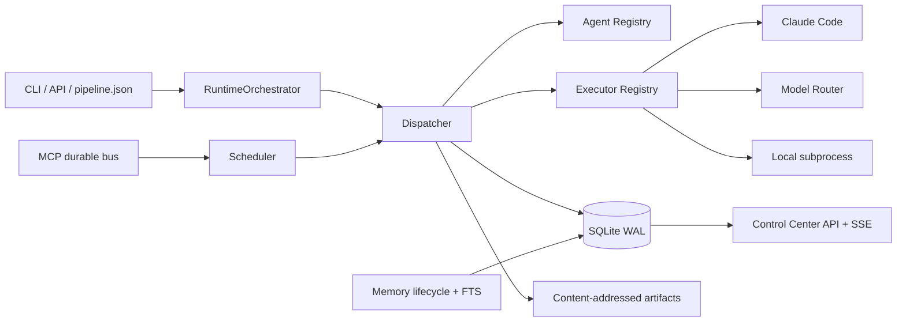
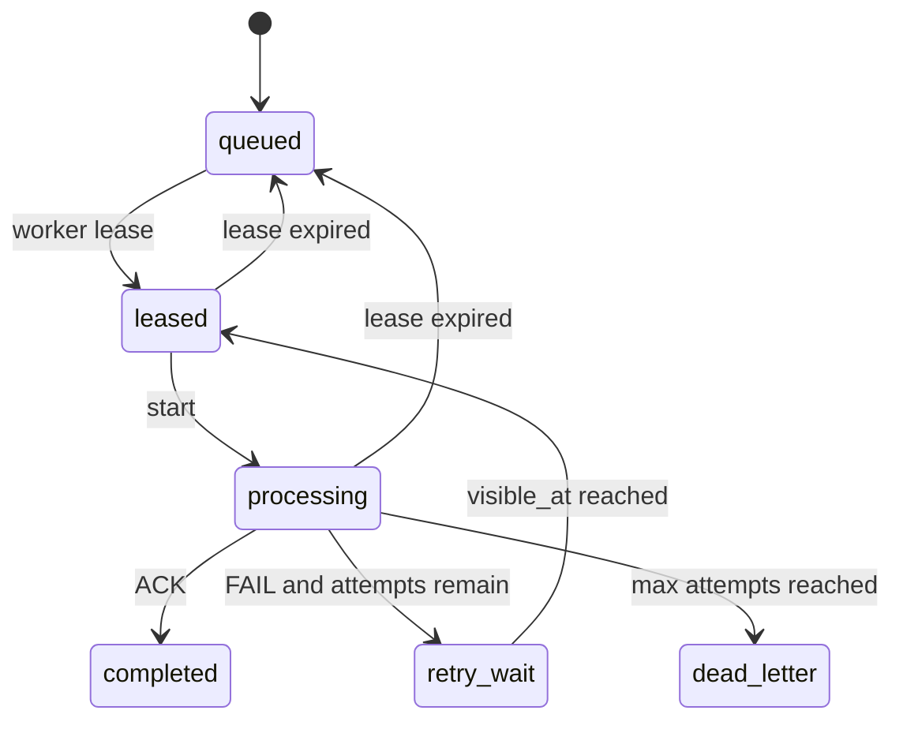

# TopAgent v3 实施设计

更新日期：2026-08-17

## 结论

TopAgent v3 已从“角色与流程说明”推进为一个单机、可执行、可观测、可恢复的
Agent Runtime 基线。它现在能回答四个以前回答不了的问题：谁执行、执行了什么、
产物在哪里、失败后如何恢复。



## 从 OpenManus / Manus 吸收的设计

| 参考思想 | v3 落地方式 | 没有照搬的部分 |
|---|---|---|
| OpenManus 把 Agent、Flow、Tool、Sandbox 分层 | Registry、RuntimeOrchestrator、Executor、workspace 分层 | 当前不内置浏览器沙箱和跨主机 sandbox |
| Manus 将文件系统作为可恢复的外部上下文 | ArtifactStore、每次 execution workspace、Markdown canonical memory | 没把完整对话无限塞回上下文 |
| Manus Context Engineering 强调可恢复压缩 | execution/event/attestation 可从 DB 重建；记忆保留来源与替代链 | 尚未实现自动上下文压缩器 |
| Manus Skills 强调按需加载 | Skill Level 1 元数据匹配，Level 2 仅加载命中全文 | 当前匹配是词元法，未上 embedding reranker |
| Agent 运行必须可观测 | execution_id、trace、事件、指标、SSE、Dashboard | 尚未输出 OpenTelemetry/OTLP |

参考来源：

- [OpenManus](https://github.com/FoundationAgents/OpenManus)
- [Manus：Context Engineering for AI Agents](https://manus.im/blog/Context-Engineering-for-AI-Agents-Lessons-from-Building-Manus)
- [Manus Skills](https://manus.im/blog/manus-skills)

## 统一执行契约

输入：

```text
ExecutionRequest {
  agent_id, task, input artifacts,
  run_id, parent_execution_id,
  constraints {timeout, max_turns, allow_paid_calls, metadata}
}
```

输出：

```text
ExecutionResult {
  execution_id, agent_id, agent_version,
  backend, model, status,
  structured_output, artifacts, metrics,
  verifier_identity, error, attestation
}
```

Runtime 会保存输入/输出哈希、Agent 版本、backend/model、事件和产物。调用失败不会
消失，而会成为 `failed` execution。真实 Claude/Router 调用必须显式授权付费。

## MCP 通信与恢复

v1 的 `unread/read` 文件队列会把“读取”误当作“完成”，并且崩溃后无法可靠判断
处理状态。v3 使用以下状态机：



幂等键有唯一约束；delivery_id 必须与 message_id 和活动租约一致；不存在的 Runtime
执行身份不能冒充已认证 Agent。旧 `from` 字段仍可用，但被标记 `attested=false`。

## 长期记忆

记忆分四个状态：

1. `candidate`：Agent 产生但未验证。
2. `active`：验证者显式 promote，进入 canonical。
3. `conflict`：同 namespace/subject 与活跃事实冲突，禁止静默覆盖。
4. `superseded` / `archived`：保留历史和替代关系。

SQLite FTS 用于本地召回；人可读 Markdown 保留在 candidates/canonical/archive。每条记忆
有 confidence、来源 execution/artifact、使用次数、验证时间、冲突和 supersedes。

## Agent 与 Skill 数量增长

Agent/Skill 文件仍是唯一事实源，SQLite 只是可重建索引：

- Level 0：仅扫描文件路径与 hash。
- Level 1：把 name/version/description/status 放入注册表，做候选筛选。
- Level 2：只加载命中的 Skill 全文。
- Level 3（待做）：执行 Skill 资源/脚本时单独授权和审计。

这避免每轮把几十个 Skill 全文装入上下文。重复或废弃定义应在注册表中标记，不能靠
“模型自己记得不用”。

## 密钥

解析顺序是环境变量 → Windows DPAPI CurrentUser vault。仓库当前版本不再保存密钥值或
Base64。vault 位于 `runtime/secrets.enc`，被 Git 忽略，写入采用临时文件原子替换并做
解密哈希验证。

边界：DPAPI 不会替你去 Provider 控制台撤销旧 key，也不会清除 Git 历史。两者需要单独
审批，因为前者是外部变更，后者会重写历史。

## 当前诚实边界

- 不同 execution 是独立执行上下文，不自动等于不同操作系统进程。
- 19 个 Agent 文件是 19 个定义，不是 19 个常驻模型。
- Control Center 是本机单用户窗口，不具备企业 RBAC。
- SQLite WAL 是单机可靠基线，不是 Kafka/NATS 的替代声明。
- v2 人工门禁与 v3 Runtime 处于兼容迁移期。
- manju-studio 三条视频 Golden Case 和 video-notes 固定样本回归不在本次 Runtime
  改造中伪造为“已完成”；它们需要稳定样本与期望快照后单独实施。
